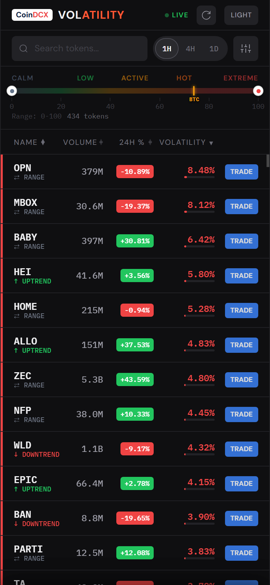
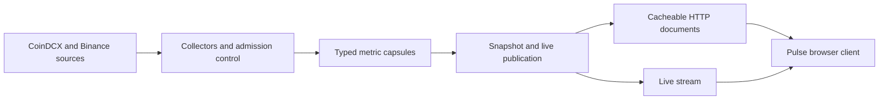

# Pulse Market Terminal

Pulse is a real-time perpetual-futures market terminal built to make volatility, positioning, open interest, funding, price change, and volume comparable across a large market universe.

It is more than a dashboard. The project includes the collection, validation, storage, publication, and browser-delivery path required to keep market data fresh without presenting missing or stale values as valid signals.

**Live product:** [dcxpulse.vercel.app/pulse](https://dcxpulse.vercel.app/pulse/)



## What it does

- Screens USDT-margined perpetual futures across 1H, 4H, and 24H views.
- Combines volatility, price change, volume, long/short positioning, open-interest change, funding, and funding change.
- Preserves source time, observation time, expiry, units, and availability for each metric.
- Publishes shared snapshots so exchange and backend work stays constant as viewer count grows.
- Streams live price updates while keeping slower metrics on independent refresh schedules.
- Supports client-side filtering, sorting, responsive detail views, and explicit trade-risk context.

## System design



The core design principle is **collect once, publish once, serve many**. Public viewers read bounded, cacheable documents; they do not trigger exchange calls or per-user model computation.

## Engineering highlights

**Freshness is part of the value.** Every published field carries enough metadata to distinguish current, stale, partial, and unavailable data. Missing values are never silently converted to zero.

**Writers are fenced.** Redis leases and monotonic ownership generations prevent an expired collector from overwriting a newer publication.

**Metrics fail independently.** A delayed funding update does not invalidate live price, and an unavailable open-interest reference does not invent a return. The UI keeps the available evidence while showing the gap.

**Publication is bounded.** Compact typed rings, compressed immutable artifacts, fixed public URLs, payload limits, and source request budgets keep memory, bandwidth, and provider traffic predictable.

**Definitions are explicit.** The canonical formulas, units, null policy, timestamps, and edge cases are documented in [docs/calculations](docs/calculations/README.md), with wire contracts in [docs/contracts](docs/contracts/README.md).

## Repository map

| Path | Purpose |
| --- | --- |
| `pulse/collectors/` | Scheduled collection, admission, composition, and recovery |
| `pulse/metrics/` | Pure metric calculations and validation |
| `pulse/store/` | Redis/memory storage, leases, rings, and publication state |
| `pulse/wire/` | Compact wire schemas and typed row encoding |
| `pulse/http/` and `pulse/api/` | Cacheable document readers and API boundaries |
| `pulse/stream/` | Live market-data bridge and bounded stream daemon |
| `frontend/` | Responsive terminal UI and shared renderer |
| `tests/` | Unit, contract, failure-path, and frontend checks |

## Run locally

Use Python 3.12 and Node 20+.

```bash
python3.12 -m venv .venv
source .venv/bin/activate
python -m pip install -r requirements.txt
npm ci

PYTHONDONTWRITEBYTECODE=1 python -m unittest discover -s tests -v
npm test
python build_cached.py
```

The frontend build uses packaged fixtures and does not require production credentials. Runtime secrets are supplied through environment variables and are intentionally absent from this repository.

## Project status

Pulse is an actively developed market-data product. The screener, metric contracts, compact publication path, live-price bridge, responsive interface, and operational recovery controls are implemented. Ongoing work focuses on longer production continuity tests, broader calibration evidence, and migration of runtime components from serverless infrastructure to a dedicated deployment architecture.

This software presents market information and research signals. It does not promise trading performance or provide financial advice.

## License

Apache-2.0. See [LICENSE](LICENSE).
